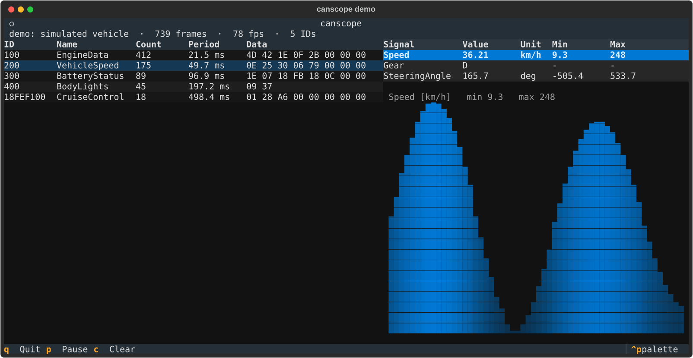

# canscope

[](https://github.com/pedrotrenado/canscope/actions/workflows/ci.yml)

A CAN bus analyzer for the terminal. It decodes traffic live with a DBC file, plots any signal, simulates a whole bus from a DBC, and records and replays logs. It works with any adapter supported by [python-can](https://github.com/hardbyte/python-can), or with no hardware at all.



## Try it

```sh
pip install git+https://github.com/pedrotrenado/canscope
canscope demo
```

`demo` starts a simulated vehicle on a private virtual bus and opens the monitor on it. The vehicle sends five messages from three ECUs, with Intel and Motorola signals, signed values, an enumeration and a 29-bit ID. Use the arrow keys or the mouse to pick a message and a signal.

| Key | Action |
|---|---|
| ↑ ↓, click | select a message or signal |
| `p` | pause the display (frames are still counted) |
| `c` | clear all statistics |
| `q` | quit |

## Commands

```sh
# Watch a real bus. The interface and channel are passed to python-can.
canscope monitor --dbc car.dbc -i slcan -c COM5 -b 500000       # CANable / slcan adapter
canscope monitor --dbc car.dbc -i pcan -c PCAN_USBBUS1 -b 500000
canscope monitor --dbc car.dbc -i socketcan -c can0             # Linux

# Record while you watch: .asc, .blf, .log, .trc, .csv, ...
canscope monitor --dbc car.dbc -i socketcan -c can0 --log drive.blf

# Replay a recording with its original timing, 4x faster, forever
canscope replay drive.blf --dbc car.dbc --speed 4 --loop

# Generate traffic for every message in a DBC, e.g. to test an ECU on the bench
canscope simulate --dbc car.dbc -i slcan -c COM6 -b 500000
```

Without `--dbc`, `monitor` and `replay` still show every ID with its count, period and raw data.

## What it shows

- **Messages**: ID (standard or extended), DBC name, frame count, **measured period**, and the last payload. The period is a smoothed inter-arrival time, so it is easy to spot a message that is late or missing.
- **Signals** of the selected message: decoded physical value with its unit, enumerations by name (`Gear: D`), and the min/max seen so far.
- **Plot** of the selected signal's recent history.
- **Status line**: total frames, frames per second, number of IDs, error frames, and the log file, if any.

## How it works

```
  CAN adapter ──► python-can Bus ──► Notifier thread ──► queue ──┐
  (or simulator / replay thread on a virtual bus)                  │ every 100 ms
                                                                   ▼
                               Textual UI ◄── BusMonitor (model): stats, DBC decoding
```

- **The receive path never touches the UI.** The python-can `Notifier` thread only pushes frames into a queue. The UI drains the queue on a 100 ms timer, feeds the frames to the model and redraws only the rows that changed. A busy bus costs one queue operation per frame on the receive side, and the UI does not redraw for every frame.
- **The model (`model.py`) has no UI code.** It tracks per-ID statistics and decodes with [cantools](https://github.com/cantools/cantools). A standard and an extended frame with the same numeric ID are kept apart, and frames that fail to decode are still counted.
- **The simulator works with any DBC.** Each signal gets a smooth waveform inside its `[min|max]` range, limited to what its raw field can hold and snapped to its resolution. Flags toggle and enumerations step through their values. Every message is sent at its `GenMsgCycleTime`, scheduled against deadlines so the timing does not drift.

## Development

```sh
python -m venv .venv
.venv/bin/pip install -e ".[dev]"      # Windows: .venv\Scripts\pip
.venv/bin/pytest
.venv/bin/ruff check . && .venv/bin/ruff format --check .
```

The 34 tests cover:

- **The model:** decoding, enumerations, extended IDs, period estimation, bad frames and error frames.
- **The simulator:** every simulated value passes cantools' strict range check, and each message is sent at its cycle time.
- **Replay:** frame order, original timing, speed factor and stopping.
- **The UI itself:** it runs headless with Textual's test pilot, which selects messages and signals and checks the tables, the plot, pause, clear and recording.

CI runs everything on Linux with Python 3.10, 3.12 and 3.14, and on Windows with Python 3.14.

`python tools/screenshot.py` regenerates the screenshot above from a headless run of the demo.

## Related

[canpack](https://github.com/pedrotrenado/canpack) is a C library that packs and unpacks the same DBC signal layouts on a microcontroller, tested against the same cantools reference.

## License

[MIT](LICENSE)
